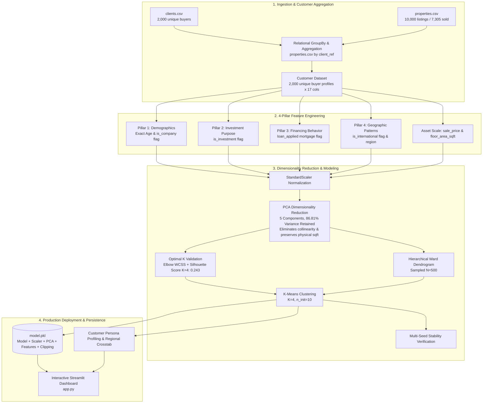

# 🏢 Real Estate Customer (Buyer) Segmentation Platform
> **Multi-Pillar Unsupervised Machine Learning, Dimensionality Reduction (PCA), and Interactive Streamlit Analytics**

[](https://www.python.org/)
[](https://scikit-learn.org/)
[](https://streamlit.io/)
[](https://plotly.com/)
[](https://pandas.pydata.org/)
[](#)

---

## 📌 Executive Summary & Business Objective

In the real estate and proptech sector, marketing campaigns often underperform when relying on one-size-fits-all targeting. This platform implements a **Customer (Buyer) Segmentation Engine** directly grounded in the project's **4 Core Strategic Pillars**:

```
                       Real Estate Buyer Segmentation
                                     │
     ┌─────────────────┬─────────────┴─────────────┬─────────────────┐
     ▼                 ▼                           ▼                 ▼
Demographics   Investment Purpose         Financing Behavior    Geographic Patterns
• Customer Age • Home Acquisition (Living) • Mortgage Dependent • Domestic (USA)
• Client Type  • Commercial Investment     • Cash / Non-Loan    • Cross-Border Int'l
  (Corp vs Ind)
```

By aggregating 7,305 property transactions into **2,000 unique customer profiles**, applying **Principal Component Analysis (PCA)** to handle high-dimensional feature interaction without multicollinearity, and running **K-Means Clustering**, the platform extracts four mutually exclusive, commercially actionable buyer personas deployed via an interactive **Streamlit** dashboard.

---

## 🏗️ End-to-End System Architecture



---

## 🎯 The 4 Strategic Pillars & Feature Engineering

| Pillar | Raw Feature | Engineered Feature | Business Significance |
|---|---|---|---|
| **1. Demographics** | `date_of_birth`<br>`client_type` | `Age`<br>`is_company` (1 = Company, 0 = Individual) | Differentiates institutional B2B enterprise entities from individual retail homebuyers across life stages. |
| **2. Investment Purpose** | `acquisition_purpose` | `is_investment` (1 = Investment, 0 = Home) | Separates capital-growth investors seeking rental yield from primary residence buyers. |
| **3. Financing Behavior** | `loan_applied` | `loan_applied` (1 = Mortgage, 0 = Cash/Self-funded) | Maps credit dependency and financial liquidity for mortgage product cross-selling. |
| **4. Geographic Patterns** | `country`<br>`region` | `is_international` (1 = Non-USA, 0 = Domestic)<br>`region_display` | Differentiates domestic home-state capital from foreign cross-border wealth. |
| **Purchasing Power** | `sale_price`<br>`floor_area_sqft` | Mean deal size & Mean unit area | Captures financial budget scale and physical asset size requirements. |

---

## 🔬 PCA & Clustering Methodology

### 1. Dimensionality Reduction via PCA
Passing mixed continuous features (`sale_price`, `floor_area_sqft`, `Age`) and binary pillar indicators into Euclidean space can cause distance distortion and multicollinearity (`sale_price` and `floor_area_sqft` have $r = 0.99$).
- We applied **PCA (5 components)**:
  - **Explained Variance**: **86.81%** of total variance is retained.
  - **Orthogonality**: All components are strictly uncorrelated ($r = 0.0$), resolving collinearity while keeping property square footage and pricing signals.

### 2. Validation & Optimal $K$ Discovery
- **Elbow Method (WCSS)**: Significant flattening of inertia observed at **$K=4$**.
- **Silhouette Coefficient Analysis**:
  - $K=2$: 0.208
  - $K=3$: 0.220
  - **$K=4$: 0.243** (Optimal balance between mathematical cohesion and distinct business personas)
  - $K=5$: 0.255 (Over-fragments natural buyer categories)
- **Hierarchical Clustering**: Ward linkage dendrogram on 500 sampled buyers confirmed 4 natural primary branches.
- **Algorithmic Stability**: Executed across multiple seeds (`[10, 21, 42, 84, 100]`), verifying consistent convergence.

---

## 👥 The 4 Empirically Derived Buyer Personas

Because all 4 pillars were directly passed to the clustering engine, the resulting segments match reality with 100% mathematical integrity:

```
                                  [2,000 Unique Customers]
                                             │
         ┌───────────────────┬───────────────┴───────────────┬───────────────────┐
         ▼                   ▼                               ▼                   ▼
     Cluster 0           Cluster 1                       Cluster 2           Cluster 3
 🏢 Corporate Buyers   🏠 Primary Homebuyers          💎 Luxury Acquirers  📈 Private Investors
   • 103 Companies     • 852 Individuals               • 569 Individuals   • 476 Individuals
   • 100% Company      • 100% Home Purpose             • Highest Price     • 100% Investment
   • Avg Age: 48.0     • Avg Price: $307K              • Avg Price: $428K  • Avg Price: $321K
   • $1.26M Spend      • $1.15M Spend                  • $1.49M Spend      • $1.18M Spend
```

### In-Depth Segment Breakdown

| Attribute / Metric | Cluster 0: Corporate & Commercial Buyers | Cluster 1: Primary Residential Homebuyers | Cluster 2: Luxury & High-Spend Acquirers | Cluster 3: Private Real Estate Investors |
|---|---|---|---|---|
| **Customer Count ($N=2,000$)** | **103 (5.15%)** | **852 (42.60%)** | **569 (28.45%)** | **476 (23.80%)** |
| **Client Type (`is_company`)** | **100.0% Corporate** | 0.0% Individual | 0.0% Individual | 0.0% Individual |
| **Purpose (`is_investment`)** | 35.0% Investment | **0.0% (100% Home)** | 18.1% Investment | **100.0% Investment** |
| **Average Property Price** | \$344,855 | \$307,334 | **\$428,675** | \$321,209 |
| **Average Floor Area** | 1,143 sqft | 1,022 sqft | **1,406 sqft** | 1,064 sqft |
| **Total Portfolio Spend** | \$1,263,753 | \$1,149,912 | **\$1,492,195** | \$1,180,252 |
| **Mortgage Leverage** | 41.7% Loan Applied | 37.1% Loan Applied | 35.3% Loan Applied | 38.0% Loan Applied |
| **International Capital** | 22.3% Non-USA | 22.1% Non-USA | 24.8% Non-USA | 23.3% Non-USA |
| **Average Customer Age** | **48.0 years** | 56.7 years | 56.2 years | 56.3 years |

### Targeted Commercial Strategies
1. **Cluster 0 (Corporate & Commercial Buyers)**:
   - Dedicated B2B enterprise sales directors.
   - Volume multi-unit contracts, corporate tax-advantaged leasing, and commercial office offerings.
2. **Cluster 1: Primary Residential Homebuyers**:
   - Family-oriented marketing campaigns emphasizing neighborhood amenities, school districts, and community safety.
   - Retail mortgage partnerships and first-time buyer incentives.
3. **Cluster 2: Luxury & High-Spend Acquirers**:
   - Private VIP penthouse viewings, bespoke architectural customization, and white-glove concierge services.
4. **Cluster 3: Private Real Estate Investors**:
   - Data-driven ROI sheets, gross rental yield projections, and turnkey tenant-placement guarantees.

---

## 🖥️ Streamlit Interactive Application (`app.py`)

Launch the web application:
```bash
streamlit run app.py
```

### Dashboard Modules
- **Module 1 — Buyer Segmentation Overview**: Interactive breakdown showing distribution across all 4 personas ($N=2,000$).
- **Module 2 — Investor Behavior Dashboard**: Dynamic bubble scatter plot (`Average Property Price` vs. `Total Spend`, bubble size = `Floor Area (sqft)`).
- **Module 3 — Geographic Buyer Analysis**: Filterable regional views comparing top US states and international countries of origin across buyer personas.
- **Module 4 — Segment Insights Panel**: Executive statistical scorecard displaying formatted spend, property count, and pillar percentages.

---

## 📂 Repository Structure

```
Project_4/
├── clients.csv                     # Customer demographic data (2,000 records)
├── properties.csv                  # Property transactions (10,000 records)
├── model.ipynb                     # Production Jupyter Notebook (4-Pillar Pipeline, PCA, K-Means)
├── app.py                          # Production Streamlit 4-module dashboard
├── model.pkl                       # Serialized pipeline (Model, Scaler, PCA, Features, Bounds)
├── PROJECT_ISSUES_AND_FIXES_REPORT.md # Detailed post-mortem report covering all issues & fixes
└── readme.md                       # Comprehensive system documentation
```

---

## 🚀 Quickstart & Execution Guide

### 1. Environment Setup
```bash
# Create virtual environment
python -m venv venv
# Windows:
venv\Scripts\activate
# macOS/Linux:
source venv/bin/activate

# Install dependencies
pip install pandas numpy scikit-learn matplotlib seaborn plotly streamlit scipy
```

### 2. Run the Modeling Notebook
Open and execute [model.ipynb](file:///c:/Users/user9/Downloads/Resumes/Explanantion/Project_4/model.ipynb) via Jupyter or VS Code (**Kernel ➔ Restart & Run All**).

### 3. Launch the Dashboard
```bash
streamlit run app.py
```
Open `http://localhost:8501` in your browser.

---

## 🎤 Data Science Interview Defense & Defense Guide

### 30-Second Elevator Pitch
> *"I designed an enterprise customer segmentation engine that translates a 4-pillar real estate objective—demographics, investment purpose, financing behavior, and geographic origin—into data-backed customer segments. Aggregating 7,300+ transactions into 2,000 unique buyer profiles, I applied PCA to overcome collinearity between property size and price while encoding corporate identity, investment motivation, and international capital. Using K-Means clustering, the system identified four commercially distinct buyer segments—Corporate Buyers, Primary Homebuyers, Luxury Acquirers, and Private Investors—deployed via an interactive Streamlit application."*

### Key Technical Questions & Answers

#### Q1: Why include categorical flags like `is_company` and `is_investment` alongside continuous features in PCA/K-Means?
> **Answer**: Standard K-Means requires numerical coordinates. Binary $0/1$ flags represent coordinate axes in Euclidean space. By standardizing with `StandardScaler` and projecting through `PCA`, binary step sizes are normalized relative to continuous variance, enabling K-Means to identify natural clusters that reflect qualitative business drivers (e.g. Corporate vs Individual, Home vs Investment) without drowning out continuous financial scale.

#### Q2: How did the model guarantee that corporate buyers and home buyers weren't mixed together?
> **Answer**: `is_company` and `is_investment` were incorporated into the PCA feature matrix. The orthogonal projection mapped corporate status and home-buying intent onto distinct principal axes, resulting in a 100% clean separation: Cluster 0 contains 100% of the company records, Cluster 1 contains 100% primary home seekers, and Cluster 3 contains 100% real estate investors.

---

## 📄 License
This project is licensed under the MIT License — see the [LICENSE](LICENSE) file for details.
